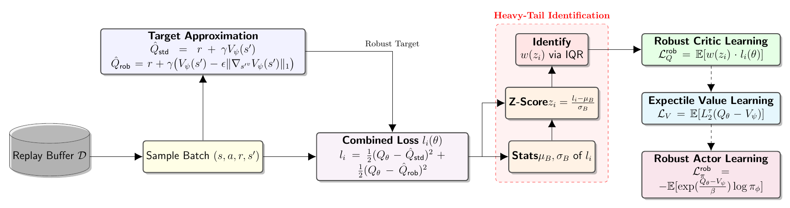

<h1 align="center">🚗 TRUST: Robust Offline RL for Autonomous Driving<br>Mitigating Heavy Tails under OOD Dynamics</h1>

<p align="center"><em>Trajectory-restricted robust offline reinforcement learning for autonomous driving.</em></p>

<p align="center">
  
</p>

<p align="center">
  <a href="https://github.com/MIRALab-USTC/TRUST"></a>
  
</p>

<p align="center"><a href="README.zh-CN.md">简体中文</a></p>

---

## 📚 Overview

**TRUST** addresses out-of-distribution dynamics in autonomous driving with two key mechanisms: **trajectory-restricted robust targets** and **IQR-based critic reweighting**. It approximates local worst-case changes to vehicle-trajectory features and emphasizes transitions with upper-tail critic losses. Within an offline actor–critic framework, the policy is updated using advantage-weighted regression. This JAX/Flax implementation provides offline training from saved transition datasets and closed-loop evaluation in ScenarioMax-processed scenarios.

The method is presented in *Robust Offline RL for Autonomous Driving: Mitigating Heavy Tails under OOD Dynamics*.

## Installation

Python 3.11 or 3.12 is required. Run the following commands to install TRUST and the dependencies for closed-loop evaluation:

```bash
git clone https://github.com/MIRALab-USTC/TRUST.git
cd TRUST
python -m venv .venv
source .venv/bin/activate
pip install -e ".[evaluation]"
```

For GPU training, install the appropriate JAX accelerator runtime for your hardware.

## Training

Provide a saved NPZ dataset or a directory of NPZ shards. The data must contain `observations`, `actions`, `rewards`, `next_observations`, `terminals`, `timeouts`, and `trajectory_mask`. Actions must be normalized to `[-1, 1]`, and the trajectory mask must select valid vehicle-trajectory features in the next observations. Export data using the same observation configuration as the policy.

```bash
python -m vmax.scripts.training.train_offline \
  dataset=womd \
  offline_dataset_path=/path/to/offline_train.npz \
  seed=0 \
  name_run=TRUST_WOMD_seed0
```

Use `dataset=nuplan` or `dataset=nuscenes` for the corresponding dataset settings. The default configuration expects 2,000,000 transitions; set `algorithm.expected_dataset_size=N` for a different size, or `algorithm.expected_dataset_size=null` to disable the size check. Checkpoints and configuration are saved under `runs/<name_run>/`.

## Closed-loop Evaluation

Evaluate a trained checkpoint on ScenarioMax-processed TFRecord scenarios:

```bash
python -m vmax.scripts.evaluate.evaluate \
  --path_model runs/TRUST_WOMD_seed0 \
  --path_dataset /path/to/scenariomax/validation.tfrecord \
  --batch_size 8
```

The TFRecords must contain SDC paths. The default shape is 10 paths with 300 points each; use `--num_paths` and `--num_points_per_path` if the stored shape differs. The default evaluation horizon is 80 steps. Reports are saved under `benchmark/<run>/<dataset-identity>/<checkpoint>/` or the directory specified by `--output_dir`.
